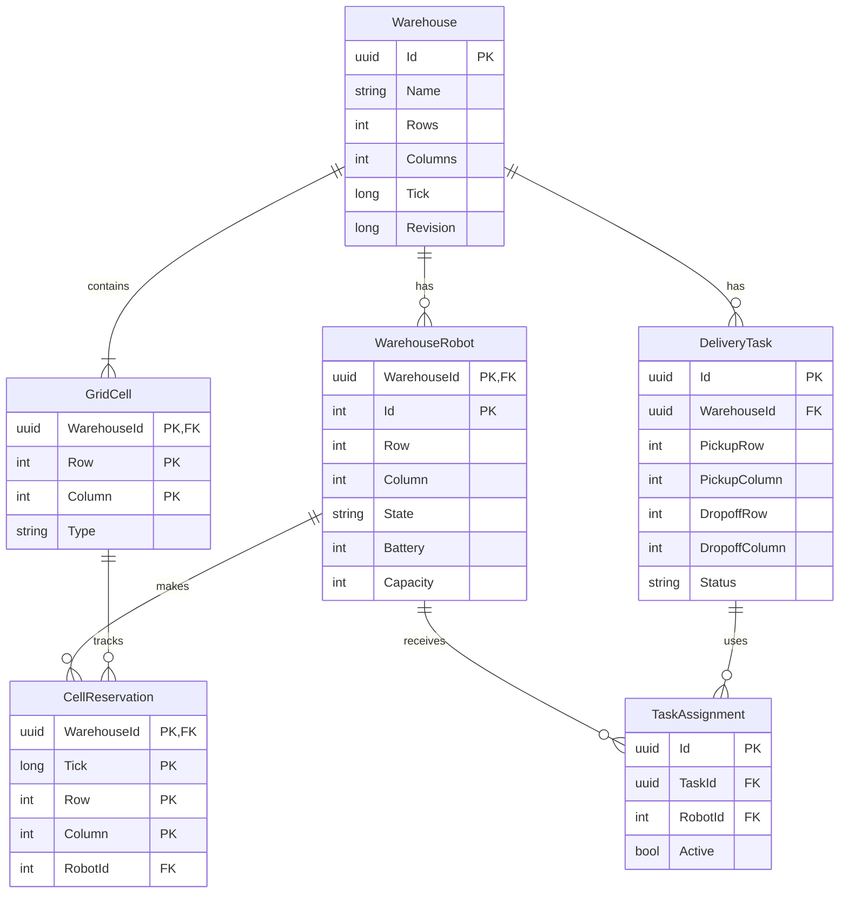

# Warehouse Robot Simulator — Database Design

## 1. ER Diagram

This diagram shows the main tables in our database and how they are connected.

## 2. Main Entities

Our database contains six main entities:

- **Warehouse:** Stores warehouse information and size.
- **GridCell:** Represents cells such as empty spaces, shelves, pickup points, and drop-off points.
- **WarehouseRobot:** Stores robot information, including position, battery, capacity, and status.
- **DeliveryTask:** Stores tasks that robots need to complete.
- **TaskAssignment:** Connects robots with their delivery tasks.
- **CellReservation:** Tracks which cells robots use during movement.

One warehouse can contain multiple robots and delivery tasks.

## 3. Business Logic

Our backend uses several rules to manage warehouse operations:

- Robots must have enough battery and carrying capacity before receiving a task.
- Busy robots cannot receive another task.
- Robots cannot move through shelves.
- Tasks must have valid pickup and drop-off locations.
- The system uses Erfan's A* algorithm to calculate routes.
- Robots are selected based on availability and route distance.
- The system checks movements to prevent robot collisions.
- Tasks can only be cancelled before the package is picked up.

These rules make our project more than a simple CRUD application.

## 4. Task and Robot States

A delivery task goes through these stages:

**Pending → Assigned → InProgress → Completed**

Tasks can also be cancelled before pickup.

Robots follow these stages:

**Idle → MovingToPickup → PickingUp → MovingToDropoff → DroppingOff → Idle**

Once a delivery is completed, the robot becomes available for another task.

## 5. Database Management

We use **PostgreSQL** to store warehouse information.

**Entity Framework Core (EF Core)** connects our C# classes to the database.

We also use **EF Core Migrations** to create and update the database structure without writing SQL scripts manually.

Database transactions and revision checks help prevent conflicting updates and ensure that related changes are saved together.

## 6. Robot Movement

Each simulation tick represents one step of the simulation.

During each tick:

1. The system checks the robot's task.
2. It calculates a route using A*.
3. It checks for possible movement conflicts.
4. The robot moves if the next cell is safe.
5. The new state is saved in PostgreSQL.

Moving uses battery power, while waiting does not.

Currently, we support basic safe movement and collision checks. More advanced features, such as automatic charging and deadlock recovery, will be implemented later.

## 7. Testing

We tested the backend using **xUnit**.

All 41 tests passed, including simulation, API, business logic, and database tests.

We also successfully completed a robot delivery in six simulation ticks and verified that its information was saved in PostgreSQL after restarting the API.
