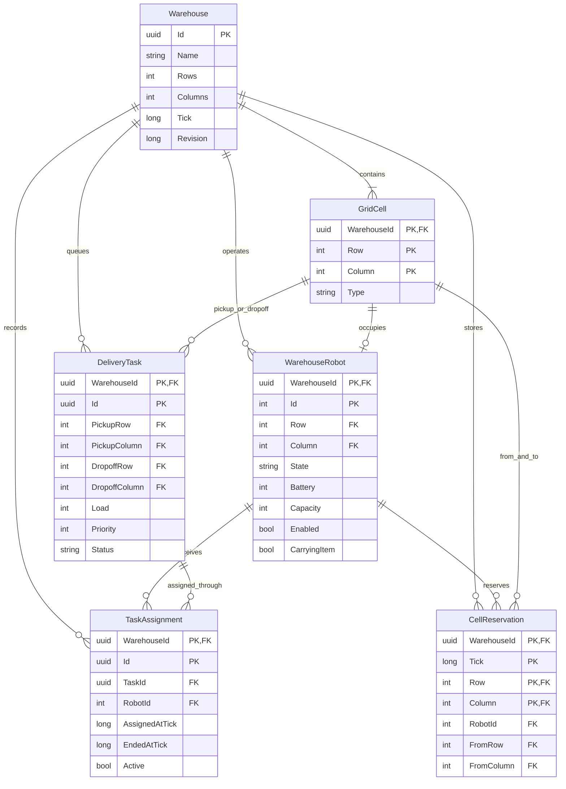
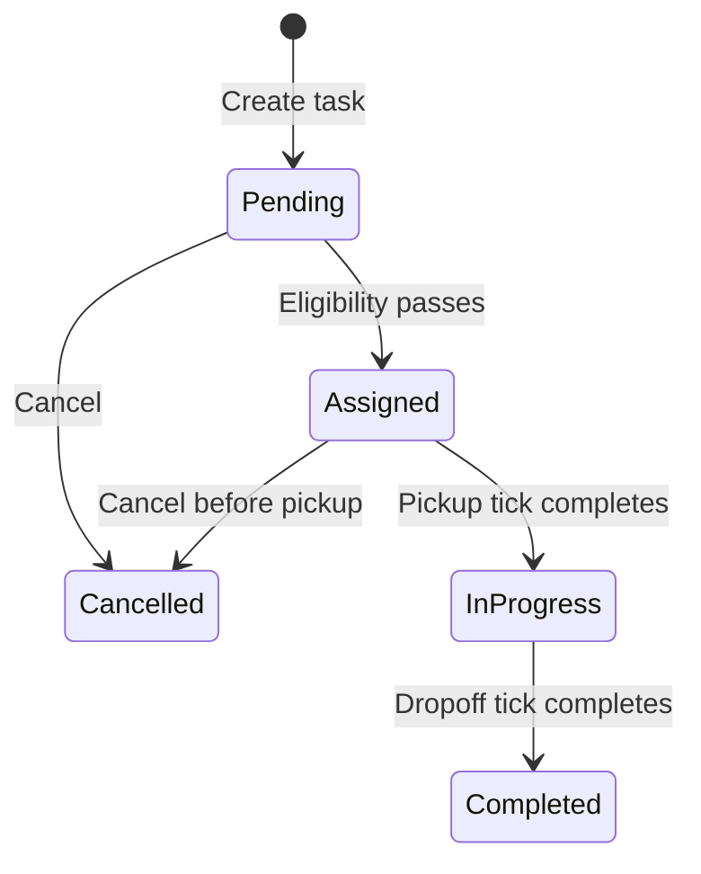

# Persisted domain and rules

`Shelf` is the existing simulation library's impassable obstacle type. A separate
obstacle table is unnecessary for the current four cell types. Every warehouse
persists every grid cell, including `Empty`. Composite foreign keys keep robots,
task endpoints, assignments and reservations within the same warehouse.

The database enforces one robot per current cell, one active assignment per robot,
one active assignment per task, one reservation per cell/tick, and one reservation
per robot/tick. Assignment history survives completion and cancellation. Only the
latest committed tick's reservations are retained.

## Business invariants

- Robots start on distinct walkable cells, with battery 0–100 and capacity 1–1000.
  Disabled, busy and carrying robots cannot be assigned.
- Tasks require existing `Pickup` and `Dropoff` cells, load 1–1000 and priority 0–10.
  Both route legs must be reachable. Capacity must cover the load.
- Battery eligibility uses the A* distance to pickup plus the A* delivery
  distance plus a reserve of 10. One move costs one battery unit; waiting,
  pickup and dropoff cost zero in this first policy.
- Eligible robots are passed to Erfan's nearest-path selector, retaining his
  lowest-ID tie breaker. Assignment is explicit for a chosen pending task;
  task priority currently governs movement conflicts, not an automatic queue.
- Only pending tasks can be assigned. Pending or assigned tasks can be cancelled
  before pickup; carrying work cannot be cancelled. Clients cannot directly set
  robot state, task status, positions or battery.
- Layout edits are rejected while an assignment is active. A shelf cannot replace
  an occupied cell, and a station referenced by a task cannot change its type.

Robot states reuse `Simulation.Models.RobotState` exactly:
`Idle → MovingToPickup → PickingUp → MovingToDropoff → DroppingOff → Idle`.
Arrival changes the movement state; the next tick performs pickup or dropoff.

## Atomicity

Every command reads the aggregate in an EF transaction with PostgreSQL
`RepeatableRead`, checks the client's expected revision, applies rules and increments
the warehouse revision. EF also treats the revision as a concurrency token.
The transaction commits robot, task, assignment and reservation changes together.
Concurrent-write/serialization conflicts return HTTP 409 and roll back the entire
command. Read snapshots also use a transaction so split collection queries cannot
mix different ticks.

## Movement scope

Each tick asks the existing A* algorithm for a route while treating other robots'
starting cells as blocked. Candidates are considered by task priority descending,
then robot ID ascending, and Erfan's collision checker rejects conflicting moves.
Waiting/idle robots receive reservations too. All moves are then applied together.

This conservative policy also forbids following another robot into a cell it
vacates in the same tick. It does not guarantee progress in a narrow corridor.
Repeated waits, starvation prevention and deadlock recovery need a later scheduler.
Detours can consume more battery than the assignment's static estimate; movement
stops at the reserve threshold. Charging/recovery is a later increment.
