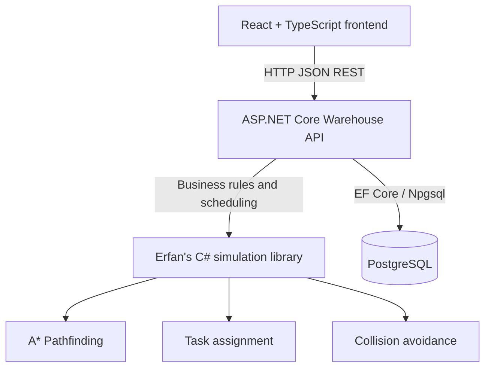
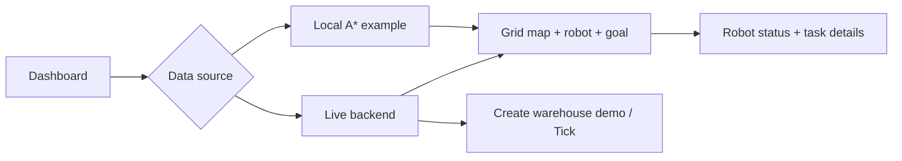

# Frontend architecture and presentation visuals

## Architecture diagram

**Current boundary:** React draws positions; the API processes state transitions; the simulation library owns A*, task assignment and collision checking. The frontend does **not** implement those algorithms.

## User interface diagram

## Presentation screenshot checklist

- [ ] Full dashboard with the robot icon, visible racks, legend and GOAL flag
- [ ] A* sample map before movement and at arrival
- [ ] Live mode, real robot/state, and a completed backend task (if Yamen's server is available)
- [ ] Show these two diagrams in slides, and explain the JSON boundary

## Technical content to collect

From **Yamen**: `backend/Warehouse.Api/Program.cs`, `backend/Warehouse.Api/Contracts/WarehouseSnapshot.cs`, `docs/backend-contracts.md`, `docs/backend-setup.md`; mention ASP.NET Core, PostgreSQL, EF Core, revision-guarded tick endpoints.

From **Erfan**: `backend/Simulation/Models`, `backend/Simulation/Algorithms` (or corresponding implementation), demo output showing a seven-step A* path; mention shortest-path navigation, assignment, and collision checks.
